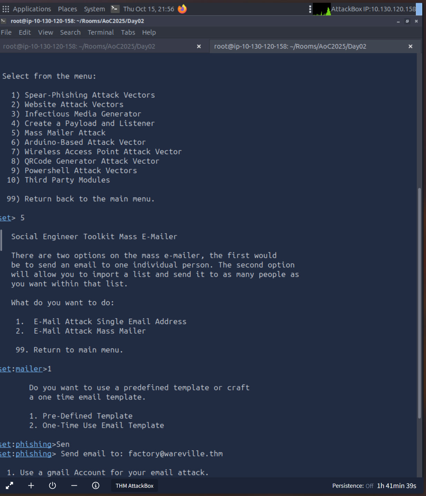
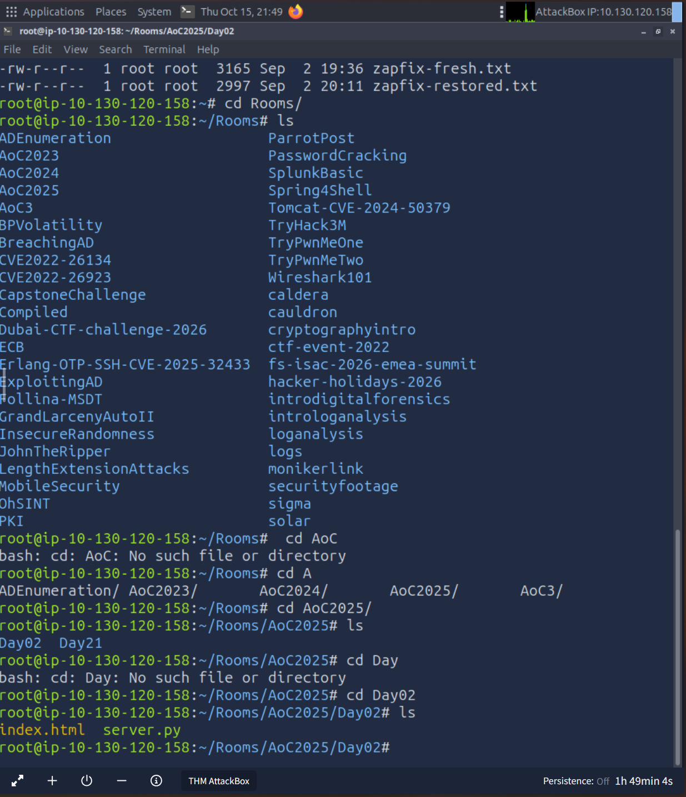
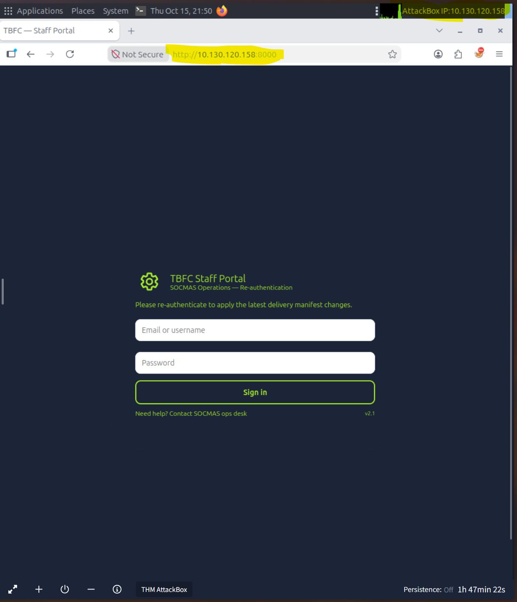
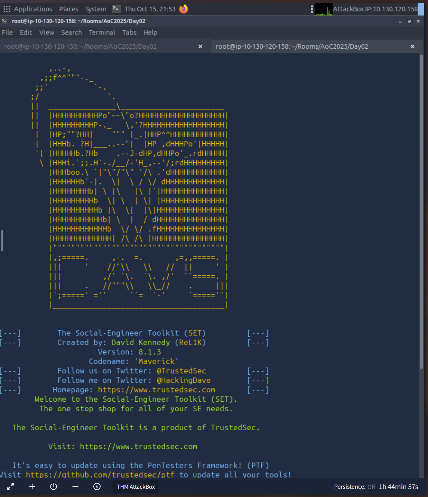
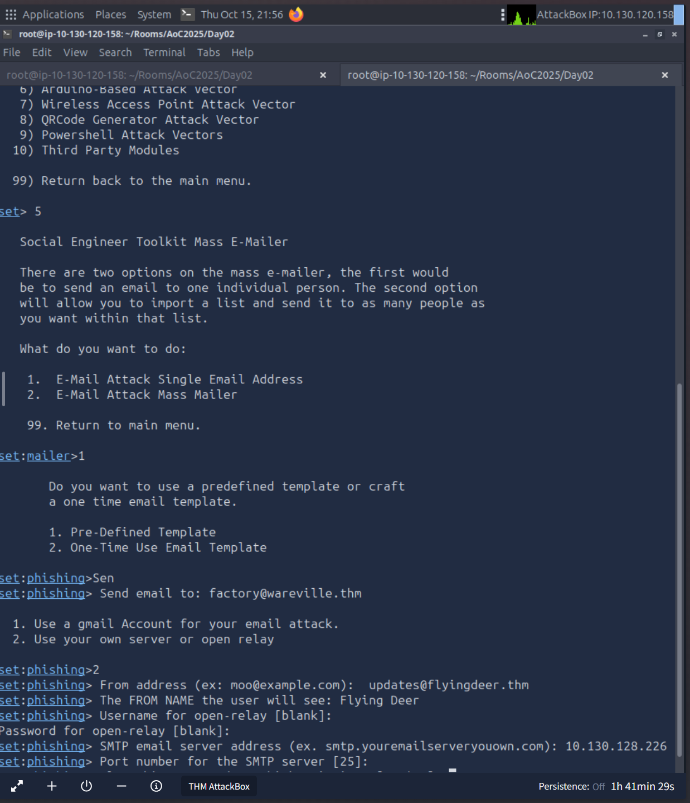
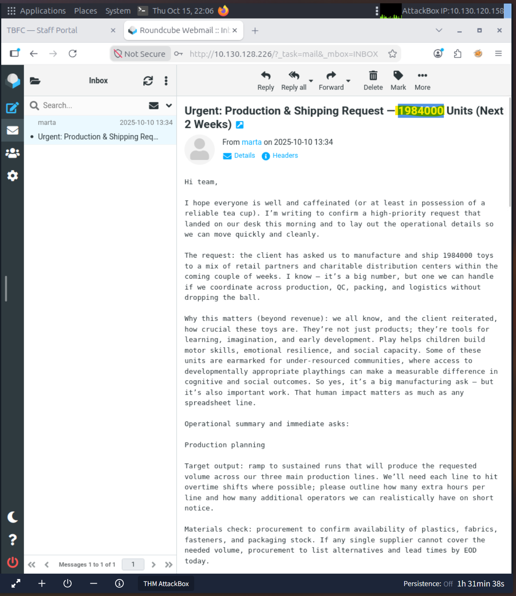
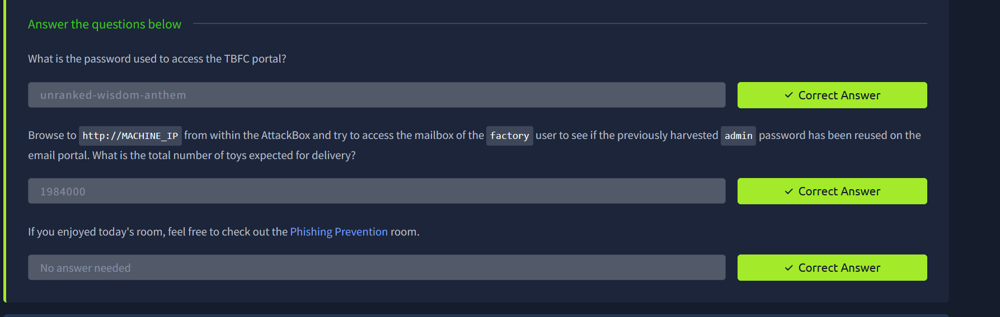

# Phishing — Merry Clickmas

A spoiler-filled walkthrough for **TryHackMe Advent of Cyber 2025, Day 2: “Phishing — Merry Clickmas.”** This room demonstrates a phishing chain in a deliberately isolated lab: host the supplied TBFC lookalike page, use the room's mail setup to deliver a test message, then see how credential reuse exposes a mailbox.

> **Authorized-lab use only.** The commands, sender, recipient, and IP addresses below are for the TryHackMe room. Do not send test mail to real people or systems. Lab IPs are temporary; use the addresses shown in your own session, not the screenshot examples.
>
> **Spoilers:** accepted answers are listed near the end.

## Room at a glance

| Item | Value |
|---|---|
| Room | Advent of Cyber 2025 — Day 2 |
| Theme | Phishing and credential reuse |
| AttackBox files | `~/Rooms/AoC2025/Day02/index.html`, `server.py` |
| Portal | TBFC Staff Portal, served on port `8000` in the screenshot |
| Mailbox | Roundcube, reached at the target machine's HTTP address |

### Attack chain

```text
Provided TBFC login page
        ↓
Controlled one-recipient email simulation (SET)
        ↓
Portal password obtained in the lab
        ↓
Password reuse against the factory mailbox
        ↓
Read the production request and recover the toy quantity
```

The addresses visible in the attached evidence are `10.130.120.158` for the AttackBox and `10.130.128.226` for the target. Treat these as examples only. In the steps below, `<ATTACKBOX_IP>` and `<TARGET_IP>` mean the current addresses displayed by your room.

## Walkthrough

### 1. Locate and serve the provided portal

In the AttackBox terminal, inspect the Day 2 room directory. The supplied files are `index.html` and `server.py`:

```bash
cd ~/Rooms/AoC2025/Day02
ls
```

Start the room's server from that directory:

```bash
python3 server.py
```

From the AttackBox browser, open:

```text
http://<ATTACKBOX_IP>:8000
```

The page imitates a **TBFC Staff Portal** and asks the user to re-authenticate to apply “the latest delivery manifest changes.” The screenshot also shows that the page is served over plain HTTP. In a real environment, never enter credentials into a link reached from an unexpected email; verify the site through a known bookmark or trusted channel.

<details>
<summary>Evidence: room files and portal page</summary>





</details>

### 2. Configure the room's single-recipient mail simulation

Launch the Social-Engineer Toolkit (SET) in the AttackBox and follow the single-recipient path shown in the room:

```bash
setoolkit
```

1. Choose **5 — Mass Mailer Attack**.
2. Choose **1 — E-Mail Attack Single Email Address**.
3. Choose **2 — One-Time Use Email Template**.
4. Set the recipient to `factory@wareville.thm`.
5. Choose **2 — Use your own server or open relay**.
6. Use the room's SMTP endpoint and the lab sender values below. Leave relay credentials blank only because this isolated room's relay is configured for the exercise.

| SET field | Room value shown in the evidence |
|---|---|
| From address | `updates@flyingdeer.thm` |
| From/display name | `Flying Deer` |
| SMTP server | `<TARGET_IP>` (shown as `10.130.128.226`) |
| SMTP port | `25` |
| Recipient | `factory@wareville.thm` |
| Link in the one-time message | `http://<ATTACKBOX_IP>:8000` |

Use the current room addresses if they differ. Keep the message and delivery strictly inside the lab; do not substitute real recipients, external mail servers, or public URLs. The screenshots show the SET startup, menu selections, and SMTP configuration.

<details>
<summary>Evidence: SET menu and SMTP setup</summary>







</details>

### 3. Use the portal password in the intended lab flow

The provided page is the controlled credential-capture endpoint for the room. After the lab's simulated interaction supplies the login, carry the captured password into the next step. The first room question asks for the password used to access the TBFC portal; its accepted value is:

```text
unranked-wisdom-anthem
```

The important lesson is not the particular password: a convincing re-authentication prompt can capture a password, and reusing it on another service turns one compromised account into access to more data.

### 4. Check the factory mailbox

From the AttackBox, browse to the target's Roundcube webmail:

```text
http://<TARGET_IP>/
```

Sign in to the **factory** mailbox using the room credential above. The inbox contains a message from Marta (`marta`) dated `2025-10-10 13:34`, titled:

> **Urgent: Production & Shipping Request — 1984000 Units (Next 2 Weeks)**

The body confirms that the client expects **1,984,000 toys** to be produced and shipped within the next two weeks. Enter the answer without comma separators if the room asks for the raw number.

<details>
<summary>Evidence: Roundcube message</summary>



</details>

## Answers

| Question | Answer |
|---|---|
| What is the password used to access the TBFC portal? | `unranked-wisdom-anthem` |
| What is the total number of toys expected for delivery? | `1984000` |
| Optional Phishing Prevention room prompt | No answer needed |

The room's completed-answer screenshot is included below.

<details>
<summary>Show completed room answers</summary>



</details>

## What this room teaches

- **Verify unexpected re-authentication requests.** A plausible operational pretext (“delivery manifest changes”) can make a login prompt feel routine.
- **Treat transport security as a baseline.** The mock portal is plain HTTP; passwords entered over HTTP can be exposed in transit.
- **Never reuse passwords.** A password used for the staff portal also works for the factory mailbox in this scenario.
- **Use layered defenses.** Unique passwords, MFA, phishing-resistant authentication, mail authentication controls, and a verified reporting process reduce the impact of a single click.

## Repository contents

```text
.
├── README.md
└── screenshots/
    ├── 01-day02-files.png
    ├── 02-set-toolkit.png
    ├── 03-set-mailer-menu.png
    ├── 04-set-smtp-configuration.png
    ├── 05-tbfc-portal.png
    ├── 06-factory-mailbox.png
    └── 07-room-answers.png
```
